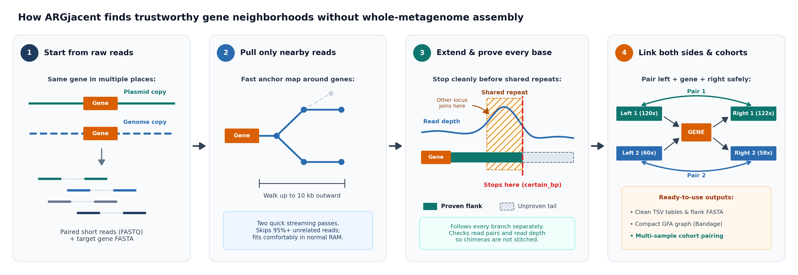

# ARGjacent

**Certified genomic contexts of antibiotic resistance genes (or arbitrary target genes) directly from paired short-read metagenomes, without whole-metagenome assembly.**

ARGjacent reconstructs the upstream and downstream flanking DNA (default 10 kb per side) around every copy of every target gene directly from raw paired-end short reads. When a gene occurs in multiple genomic neighborhoods within the same sample (distinct plasmids, chromosomes, strains, or mobile elements), ARGjacent separates each structural branch and certifies base by base how far the reads themselves prove that molecules carrying the gene continue along that flank (`certain_bp`), stopping cleanly before unresolvable repeats rather than stitching chimeras.



---

## How It Works

1. **Minimizer anchor graph and directed outward walk (`aw`, two streaming passes):**
   Pass 1 scans all paired reads, extracts canonical minimizers (`k=31, w=20`, roughly one anchor per 10.5 bp), discards singleton sequencing errors with a Bloom filter, and records directed edges between consecutive anchors observed in the same read along with their exact base distance and read support. Starting from anchors inside each target gene, ARGjacent walks strictly outward (no backtracking) along these directed links up to distance `D` (default 10 kb per side). At every branch, the gene's read share splits in proportion to link counts, and branches carrying less than `--min-share` (default `0.2%`) are pruned so repeats stay bounded. Pass 2 streams the reads once more and recruits every read pair in which at least one mate hits a reached anchor.
2. **Variant-aware local extension and branch separation (`awx`):**
   Starting from each gene end (using both the database reference end and the sample's own inferred terminal 300 bp), ARGjacent extends outward one base at a time from reads overlapping by at least 31 bp. Single-base SNPs, small indels, and short variant patches that reconverge within 31 to 60 bp remain on the same path, and reads differing only at known variant sites stay active (up to 4 sites per read) so they can phase downstream junctions. Sustained structural divergence (plasmid vs chromosome junctions, mobile element boundaries) forks into separate candidate arms (up to `--max-paths`, default 16 per side), explored in order of read share.
3. **Dual strict and tolerant verification (`awv` + `verify.py`):**
   All recruited read pairs are mapped back onto every candidate in a single fused strict (exact) and tolerant (SNP/small-indel aware) pass. A position along a flank is certified (`certain_bp`) only if molecules originating in the gene demonstrably continue past all incoming foreign-locus joins, verified by spanning paired-end templates, an own-read budget allowing 20% coverage unevenness, and read depth exceeding incoming foreign joins (with a 30 bp safety margin withheld at the cutoff). When another locus joins inside the gene's final 100 to 300 bp, `certain_end_bp` separately reports how far the flank is certified for genes sharing that terminal 100 bp.
4. **GFA compaction, two-sided pairing, and cohort deconvolution (`gfa.py`, `pair.py`, `cohort.py`):**
   Shared candidate prefixes and suffixes are compacted into a round-trip lossless blunt-end (`0M`) GFA v1.0 graph split at exact certainty boundaries (`gene`, `certain`, `end_only`, `candidate`) with 100-bp depth bins (`depth_bins`). Left and right flanks are linked (`[left + gene + right]`) across four strictly ordered tiers: direct read-pair spans across short genes (`<= 650 bp`), phased internal gene SNPs, unbranched (`1x1`) or flow-conserved (`1xk`) splits, and post-fork depth matching requiring 3-sigma separation from competing pairs (abstaining otherwise). Across multiple samples (`argjacent-cohort`), bidirectional weighted non-negative least squares (NNLS) with leave-one-sample-out `Delta chi^2` gating resolves tied-depth pairs (`Part A`, `S >= 2`) and explores post-repeat exits across `>= 400 bp` repeats (`Part B`, `S >= 4`) directly from `flanks.json`.

---

## Validation Summary

Evaluated with frozen `v0.5.0` code against matched single-molecule **PacBio HiFi** long reads from the same DNA samples and official **CAMI II/III** benchmarks:

- **Unseen real PacBio HiFi metagenomes (21 samples):** **9 / 2,757 (`0.33%`, 95% CI `0.15-0.62%`)** primary flanks `>= 1 kb` failed strict long-read checks (`0 / 1,388` in Block F native DNA; `9 / 1,369` across 9 additional real gut/mock metagenomes, of which 8 were single 72-80 bp tandem-repeat indels and 1 was a 74-bp structural overshoot).
- **Head-to-head on 3 real PacBio HiFi metagenomes (`H1`, `B-A2`, `H4`):** **ARGjacent `0 / 834 (0.0%)`** in 9.1 min, vs **ARGextender `11 / 79 (13.9%)`** in 18.2 min, **MEGAHIT `31 / 138 (22.5%)`** in 3 h 43 min, and **ARGContextProfiler / Sarand `50.5-52.0%`**.
- **CAMI II/III benchmarks (16 samples: Strain Madness, CAMI III Human Gut, Marine):** `1 / 384` unexplained `>= 1 kb` fault groups (`0.26%`) and `0 / 292` failures at `>= 5 kb` on Strain Madness.
- **Two-sided pairing (31 real PacBio HiFi metagenomes):** **0 / 151 (`0.00%`, 95% CI `0.00-2.41%`)** chimeras at `±500 bp` and **0 / 105 (`0.00%`)** at `±1,000 bp`, vs `16.8%` for Cartesian pairing. Across 18 multi-sample cohort samples, `argjacent-cohort` Part A added **0 / 29** chimeras at `±500 bp` while doubling multi-context recall on Strain Madness (`7.6% -> 14.1%`). Part B post-repeat extension had `0 / 108` false exits on isolated synthetic `IS26` repeats but `23.6%` failures (`35 / 148`) in chained Strain Madness repeats and should be treated as exploratory in dense repeat chains.
- **Lossless GFA v1.0 compaction (51 metagenomes, 29,720 paths):** `1.60x` sequence compaction with `0` round-trip mismatches.

Full validation protocols, per-sample tables, and forensic checks are in [benchmarks/v05_validation/RESULTS.md](benchmarks/v05_validation/RESULTS.md) and [docs/heldout-validation.md](docs/heldout-validation.md).

---

## Install

Requires Python 3.8+, `numpy >= 1.20`, a C compiler (`gcc` or `clang`), and `zlib` headers (`xcode-select --install` on macOS; `apt install gcc zlib1g-dev` on Debian/Ubuntu).

```bash
git clone https://github.com/amulyabaral/argjacent.git
cd argjacent
python3 -m pip install -U pip setuptools
python3 -m pip install .
argjacent-selftest
```

To build locally inside the repository folder without pip:

```bash
sh install.sh
sh demo/run_demo.sh
```

A Conda build recipe is also provided in `recipe/`.

---

## Usage

### Single sample

```bash
argjacent -g genes.fa -1 sample_R1.fastq.gz -2 sample_R2.fastq.gz -o results/sample
```

Inputs: paired 4-line FASTQ (plain or `.gz`, adapter-trimmed) and a FASTA of target genes. Passing a full database (e.g., ResFinder or CARD) works directly; on deep metagenomes, pre-screening detected alleles first (for example with KMA) keeps local extension faster and leaner. Key options: `-D` flank length per side (default `10000`), `-t` threads, `--max-mem` memory limit in GB, `-w` minimizer window (default `20`), `--max-paths` candidate branches per side (default `16`), `--pair-bp` pairing radius (default `500`), `--save-map` / `--map` to reuse the Pass-1 anchor graph across gene sets. Run `argjacent -h` for all options.

### Multi-sample cohort deconvolution

```bash
argjacent-cohort \
  -g genes.fa \
  -i results/s1.flanks.json results/s2.flanks.json results/s3.flanks.json \
  -o results/cohort \
  --gfa-dir results/cohort_gfa \
  -t 8
```

You can also invoke this as `argjacent cohort ...`. For cohorts with sample-specific gene FASTA files, pass `--sample-sheet samples.tsv` (columns: `sample`, `flanks_json`, optional `genes_fa`, `reads_tsv`). Gene FASTA headers must match the keys inside `flanks.json`; `--family-mode` (default `auto`) collapses ResFinder allele copies (`<allele>_<copy>_<acc>`) without colliding RefSeq, CARD, or custom gene names (`exact` disables grouping).

### Large runs on a Slurm HPC

Ready-to-run Slurm array and dependent cohort scripts live in [`hpc/`](hpc/README.md) (`make_samplesheet.py`, `submit_pipeline.sh`, `run_array.sbatch`, `run_cohort.sbatch`, `summarize_run.py`).

---

## Outputs

| File | Description |
|---|---|
| `PREFIX.summary.tsv` | One row per `(gene, side)`: `status`, candidate count, `certain_bp`, `longest_bp`, `read_depth`, `gene_end`, and `certain_end_bp`. |
| `PREFIX.contexts.tsv` | One row per candidate branch (`c1`, `c2`, ...): `length_bp`, `certain_bp`, `read_depth`, `stop`, `certain_stop`, `other_genes`, `main`, `certain_end_bp`, `shared_end_bp`. |
| `PREFIX.flanks.fa` | FASTA of all candidate flanking sequences. |
| `PREFIX.pairs.tsv` | Certified single-sample two-sided `[left + gene + right]` pairings with evidence tier and score. |
| `PREFIX.gfa` | Lossless compacted gene-centered GFA v1.0 graph with `TP:Z:`, `DP:f:`, and Bandage `CL:Z:` colors. |
| `PREFIX.flanks.json` | Full machine-readable record including `joins`, `depth_bins`, `gene_depth`, and `pairs` (input to `argjacent-cohort`). |

Example `PREFIX.summary.tsv` rows (full 10 kb flank certifies to `9970` bp after the 30 bp safety margin; a repeat 3 kb downstream stops `certain_bp` at the repeat while retaining all 4 candidate branches in `PREFIX.flanks.fa` and `PREFIX.gfa`, which opens directly in Bandage with certainty colors applied):

```text
gene                side   status    contexts  certain_bp  longest_bp  contexts_certain_1kb  read_depth  gene_end  certain_end_bp
blaCTX-M-15_1_...   left   complete  1         9970        10000       1                     42          sample    9970
blaCTX-M-15_1_...   right  partial   4         4268        10000       4                     41          sample    4268
```

---

## License and Citation

Released under the [MIT License](LICENSE). See [CITATION.cff](CITATION.cff) for citation metadata and [CHANGELOG.md](CHANGELOG.md) for release notes.
